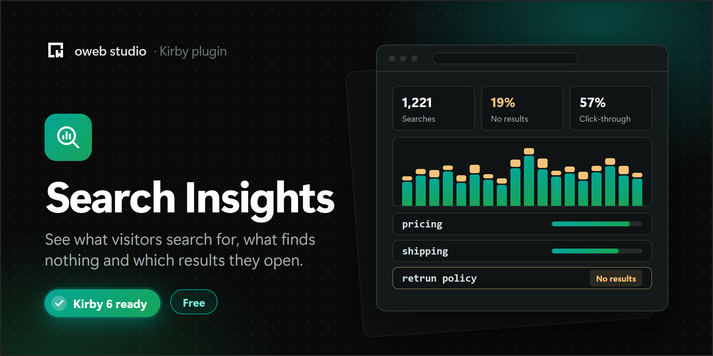

# Kirby Search Insights

Shows what visitors search for on your Kirby site, which searches find nothing and which results they open. Right in the Panel, without cookies or personal data.

## Requirements

- Kirby 6
- PHP 8.3 or newer with the `pdo_sqlite` extension (it is part of almost every PHP installation)

## Installation

1. Download the latest release
2. Unzip downloaded file
3. Copy/paste unzipped folder in your `/site/plugins` folder

Or with Composer:

```
composer require owebstudio/kirby-search-insights
```

## Setup

Kirby sites run their search in their own controller, so the plugin needs to know about it. There are two ways.

### One line in your search controller

```php
// site/controllers/search.php
return function ($site) {
    $query   = get('q');
    $results = $site->search($query, 'title|text');

    searchInsights()->track($query, $results);

    return compact('query', 'results');
};
```

`track()` works with any search: `$site->search()`, a search plugin or your own code.

- `$results` can be a collection, an array, a number or `null` when you don't know the number of results. Paginated collections count all results, not only the current page.
- Only one search per request is counted.
- `track()` never throws. If something goes wrong, the error goes to the PHP error log and your search page renders as usual.

### Or the automatic mode

```php
// site/config/config.php
return [
    'owebstudio.search-insights' => [
        'auto' => [
            'template' => 'search',  // template of your search page
            'param'    => 'q',       // query parameter
            'results'  => 'results'  // variable with the results in your controller
        ]
    ]
];
```

The plugin then counts every search when the search page renders. It reads the results from your controller's data, so the numbers are the same as on your page.

## Which results people open (optional)

Turn on click tracking:

```php
// site/config/config.php
return [
    'owebstudio.search-insights' => [
        'clicks' => true
    ]
];
```

Then mark the result links and load the script on your search page:

```php
<?php foreach ($results as $result): ?>
    <a href="<?= $result->url() ?>" <?= searchInsights()->attr($result) ?>>
        <?= $result->title()->esc() ?>
    </a>
<?php endforeach ?>

<?php snippet('search-insights/clicks') ?>
```

- The script is about 1 KB and only sends a request when a visitor opens a result (`navigator.sendBeacon()`).
- Each link carries a signed token. Nobody can post made-up searches or clicks.
- `attr()` counts the position of each result. Pass it yourself when you render results in another order: `searchInsights()->attr($result, position: 3)`.

Without click tracking, the click-through rate and the **Clicked results** tab are hidden.

## The Panel

The plugin adds a **Search insights** view to the Panel menu, with four tabs:

- **Overview:** searches, unique terms, the share of searches without results and the click-through rate, each compared with the previous period. A chart of the searches per day (per week for long periods), split into searches with and without results, also as a table. The top queries, the queries without results and the most opened pages.
- **Queries:** every term with its searches, change, average number of results, clicks, click-through rate and a trend line. Sort by clicking a column, filter, page through.
- **No results:** terms that found nothing. Typos are matched to a similar term that has results, for example `retrun policy` to `return policy`.
- **Clicked results:** the pages people opened from the search, with the queries that led there and their average position in the result list.

Click a row for the details of a term or a page. Pick the period (last 7, 30 or 90 days, 12 months or a custom range) and, on multi-language sites, the language in the header. **Export** downloads the current period as CSV.

The **…** menu has the tracking status, the ignored terms and a button to delete all data.

### Ignoring terms

Spam and test searches can be ignored from the options of a row or from the details. Their data is deleted and new searches for them are not stored. Ignored terms can be restored. Terms that should never be stored can also go into the `ignore` option.

### View button

The **Search insights** button links to the view and shows how many terms found nothing in the last 30 days. Add it to the buttons of the site view in your `config.php`:

```php
return [
    'panel' => [
        'viewButtons' => [
            'site' => ['open', 'preview', 'languages', 'searchinsights']
        ]
    ]
];
```

Or to the buttons in a blueprint, for example `site/blueprints/site.yml`:

```yaml
buttons:
  - open
  - preview
  - searchinsights
```

### Stats on the dashboard

Kirby's `stats` field can show the numbers of the last 30 days anywhere in the Panel, for example in `site/blueprints/site.yml`:

```yaml
fields:
  search:
    label: Search, last 30 days
    type: stats
    size: small
    reports: site.searchInsights.reports
```

## Privacy

Search Insights stores no personal data:

- no IP addresses, no user agents, no cookies, no session IDs;
- only the search term, the language, the day and counters (searches, searches without results, number of results, clicks and positions);
- every number is a daily total, so single visits can't be told apart.

Searches are skipped when the browser sends Do Not Track or Global Privacy Control (`respectDnt`), for bots and crawlers, and for logged-in Panel users (`panelUsers`). You can add your own check with the `consent` option, for example for your cookie banner.

You may add this to your privacy policy:

> Our site search counts the search terms that are entered, the number of results and which results are opened. These numbers are stored as daily totals without any personal data: no IP address, no browser information and no cookies. We use them to improve our content and our search.

## Options

```php
// site/config/config.php
return [
    'owebstudio.search-insights' => [
        // automatic mode, see above
        'auto' => false,

        // count which results are opened, see above
        'clicks' => false,

        // where the SQLite database is stored
        'database' => fn ($kirby) => $kirby->root('logs') . '/search-insights.sqlite',

        // days to keep, older days are deleted once a day
        'retention' => 365,

        // shorter terms are not stored, longer terms are cut
        'minLength' => 2,
        'maxLength' => 100,

        // new terms per day; more are counted as "Other terms"
        'maxTermsPerDay' => 1000,

        // terms that are never stored
        'ignore' => ['test'],

        // skip searches with Do Not Track or Global Privacy Control
        'respectDnt' => true,

        // count the searches of logged-in Panel users
        'panelUsers' => false,

        // only count searches when this returns true,
        // e.g. with the cookie of your consent banner
        'consent' => fn () => ($_COOKIE['consent'] ?? null) === 'yes',

        // change terms before they are stored, return null to skip them
        'normalize' => fn (string $term) => str_replace('ß', 'ss', $term)
    ]
];
```

Terms are always trimmed, lowercased and stored in Unicode NFC, with repeated spaces collapsed. `Return  Policy` and `return policy` are the same term. Repeated searches on page 2 and later of the results are not counted again.

### The database

The database is a single SQLite file, by default `site/logs/search-insights.sqlite`. Keep it out of Git, for example with `site/logs` in your `.gitignore`. It is small: one row per day and term. Deleting the file deletes all data.

## Permissions

Everybody who can access the view can see the numbers. To hide the view from a role, disable its area:

```yaml
# site/blueprints/users/editor.yml
permissions:
  access:
    search-insights: false
```

Ignoring and restoring terms and deleting all data need the `owebstudio.search-insights.manage` permission. It is on by default, turn it off per role:

```yaml
permissions:
  owebstudio.search-insights:
    manage: false
```

## Translations

The Panel texts are available in English, French, German and Turkish.

## License

MIT
